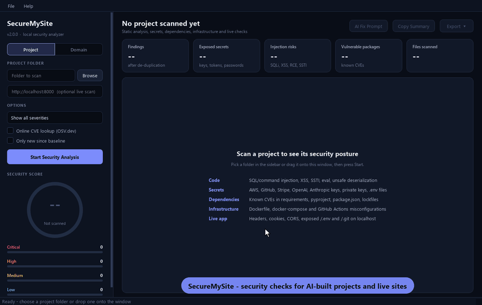

# Secure My Site  [](https://deepwiki.com/tworjaga/SecureMySite)

<div align="center">
  
</div>


A desktop + CLI security analyzer for AI-generated web projects. It finds vulnerabilities before deployment through static analysis (SAST), secret detection, dependency review, infrastructure checks and dynamic analysis of your app on localhost - and it can check the security of your live domain (DNS, DNSSEC, email spoofing protection, WHOIS, TLS, headers).

<p align="center">
  
</p>

## Features

- **Offline by default** - project scans never leave your machine (opt-in: OSV.dev dependency lookup, domain scan)
- **Domain scan (online)** - type a domain: DNS & DNSSEC, CAA, SPF/DMARC, WHOIS/RDAP expiry & transfer lock, TLS certificate & legacy protocols, HTTPS redirect, security headers, cookies, CORS, security.txt, CDN/WAF detection
- **Python SAST** - AST-based: SQL injection (incl. via variables), command injection, SSTI, eval, unsafe deserialization, hardcoded secrets, debug mode
- **JavaScript / TypeScript** - DOM XSS sinks, React/Vue raw HTML, SQL in template literals, `child_process`, open CORS, disabled TLS, insecure cookies, prototype pollution
- **HTML & templates** - inline scripts, missing SRI, mixed content, tabnabbing, unescaped Jinja/Handlebars/EJS output
- **Secret detection** - AWS, GitHub, GitLab, Slack, Stripe, Google, OpenAI, Anthropic, Hugging Face, SendGrid, npm, PyPI tokens, private keys, credentials in URLs (always masked in reports)
- **Dependencies** - `requirements*.txt`, `pyproject.toml`, `Pipfile(.lock)`, `poetry.lock`, `package.json`, `package-lock.json`, with fixed-version suggestions
- **Config** - `.env` files (git-ignored or not), hardcoded credentials, debug flags, insecure cookies, CORS/ALLOWED_HOSTS
- **Infrastructure** - Dockerfile, docker-compose and GitHub Actions workflows
- **Web (localhost only)** - real HTTP checks: security headers, cookies, CORS origin reflection, exposed `/.env` & `/.git`, debug pages, directory listing
- **Reports** - HTML (filterable), Markdown, JSON, **SARIF** (GitHub code scanning) and CSV
- **CI friendly** - `--fail-on`, baselines, inline suppressions, quiet mode, report to stdout
- **AI fix prompts** - for the whole project or a single finding
- **GUI** - dark dashboard: score, KPI cards, sortable findings with code + fix, OWASP Top 10 mapping, riskiest files, dependency & secret tables, domain profile

## Installation

Requires Python 3.11+ on Windows, macOS or Linux.

```bash
git clone https://github.com/tworjaga/SecureMySite.git
cd SecureMySite
python -m venv .venv
# Windows: .venv\Scripts\activate    macOS/Linux: source .venv/bin/activate
pip install -r requirements.txt
```

On Windows you can also just run `start.bat`.

## Usage

### GUI

```bash
python main.py
```

Pick (or drag in) a project folder, optionally enter a localhost URL, and press **Start Security Analysis**.
Switch the sidebar to **Domain** to scan a live website instead.

### CLI

```bash
python main.py ./my-project                                  # scan and print findings
python main.py ./my-project --url http://localhost:8000      # also probe the running app
python main.py ./my-project -o report.html                   # export (format from extension)
python main.py ./my-project -e sarif -o results.sarif        # SARIF for GitHub code scanning
python main.py ./my-project -e json -o - > report.json       # report to stdout
python main.py ./my-project --prompt                         # print an AI fix prompt
python main.py --list-scanners                               # show available scanners
python main.py --domain example.com                          # online domain check
```

| Option | Description |
|--------|-------------|
| `-u, --url URL` | Localhost URL to scan (localhost, 127.0.0.0/8, ::1, *.localhost, *.local) |
| `-d, --domain DOMAIN` | Online scan of a public domain (instead of a project path) |
| `--active --authorized` | Domain scan: also probe for exposed files (`/.env`, `/.git`, backups) - only on domains you own or may test |
| `-e, --export FORMAT` | `json`, `html`, `markdown`, `sarif`, `csv` |
| `-o, --output PATH` | Output file (`-` for stdout); format inferred from the extension |
| `-p, --prompt` | Generate an AI fix prompt |
| `--fail-on LEVEL` | Exit 1 if findings at/above `critical`/`high`/`medium`/`low` exist (`none` = always 0) |
| `--min-severity LEVEL` | Only report findings at or above LEVEL |
| `--baseline REPORT.json` | Hide findings already present in a previous JSON report |
| `--exclude GLOB` | Skip matching paths (repeatable) |
| `--scanners a,b` | Run only these scanners |
| `--online` | Also query OSV.dev for dependency CVEs (sends package names + versions) |
| `-q, --quiet` | One-line summary |
| `--no-color` | Plain output |
| `-v, --verbose` | Debug logging |

**Exit codes** (default): `0` no high/critical, `1` high found, `2` critical found, `3` scan/usage error.
With `--fail-on`: `1` if any finding meets the threshold, else `0`.

### Domain scan (online)

```bash
python main.py --domain example.com
python main.py --domain mysite.com -o mysite-domain.html
python main.py --domain mysite.com --active --authorized    # your own sites only
```

| Area | Checks |
|------|--------|
| DNS | A/AAAA, nameserver redundancy, CAA, **DNSSEC** (validated / not enabled / broken chain) |
| Email | SPF present and strict (`-all`), DMARC policy (`none` / `quarantine` / `reject`), MX |
| WHOIS (RDAP) | Registrar, expiry (30/60-day warnings), registrar transfer lock |
| TLS | Certificate validity, hostname match, days to expiry, issuer, TLS 1.0/1.1 still accepted |
| Website | HTTP -> HTTPS redirect, CSP/HSTS/X-Frame-Options/nosniff/Referrer/Permissions-Policy, cookie flags, CORS origin reflection, `security.txt`, server disclosure |
| Edge | CDN / WAF detection (Cloudflare, CloudFront, Fastly, Akamai, Vercel, Netlify, Azure, Sucuri, Imperva) |
| Active (opt-in) | Exposed `/.env`, `/.git`, SQL dumps, backups, debug pages, directory listings |

The domain scan is online by nature: DNS queries go to Cloudflare DNS-over-HTTPS (Google as fallback), registration data to rdap.org, and TLS/HTTP checks connect to the site like a browser. Passive checks are on by default; exposed-file probing requires `--active --authorized` (GUI: tick "I own this domain or am authorized to test it").

### Suppressing findings

```python
password = load_from_vault()  # securemysite: ignore
# securemysite: ignore-next-line
eval(trusted_expression)
```

`nosec` comments are honoured too. To skip whole paths, add a `.securemysiteignore` file to the project root (one glob per line, e.g. `legacy/` or `*.min.js`).

### Baselines

Adopting the tool on an existing project? Record today's findings and only fail on new ones:

```bash
python main.py . -o .securemysite-baseline.json --fail-on none
python main.py . --baseline .securemysite-baseline.json --fail-on high
```

Fingerprints are based on file, rule and line content, so they survive unrelated edits that shift line numbers. In the GUI use **File > Save as Baseline** and the **Only new since baseline** option.

### GitHub Actions

```yaml
- uses: actions/setup-python@v5
  with: { python-version: "3.12" }
- run: |
    git clone --depth 1 https://github.com/tworjaga/SecureMySite.git /tmp/sms
    pip install requests packaging
    python /tmp/sms/main.py . -e sarif -o results.sarif --fail-on high
- uses: github/codeql-action/upload-sarif@v3
  if: always()
  with: { sarif_file: results.sarif }
```

The CLI does not need PyQt6. (`upload-sarif` requires GitHub code scanning to be enabled for the repository.)

## Security Score

Starts at 100 and deducts per finding: CRITICAL 15, HIGH 10, MEDIUM 5, LOW 2. Each severity bucket has a cap (75 / 40 / 20 / 10) so progress stays visible as you fix things, and any unresolved CRITICAL keeps the score at 49 or below.

| Score | Grade | Risk Level |
|-------|-------|------------|
| 80-100 | A+ | Safe |
| 70-79 | A / A- | Safe / Moderate |
| 55-69 | B+ to B- | Moderate |
| 40-54 | C+ to C- | High Risk |
| 0-39 | D+ to F | Critical Risk |

## Scanners

| Name | Covers |
|------|--------|
| `python_sast` | Python source (AST + regex) |
| `javascript_scanner` | JS/TS/JSX/Vue/Svelte |
| `html_scanner` | HTML and Jinja/Django/Handlebars/EJS templates |
| `config_scanner` | `.env*`, JSON/YAML/TOML/INI config, sensitive files |
| `dependency_scanner` | Python and npm manifests and lockfiles |
| `secrets_scanner` | Provider-specific tokens in every text file |
| `iac_scanner` | Dockerfile, docker-compose, `.github/workflows` |
| `web_scanner` | Running app on localhost (`--url`) |
| `domain_scanner` | Live public domain (`--domain`, online) |

The bundled vulnerability database is `assets/vuln_db.json`. Add your own advisories in `assets/vuln_db.local.json` (same format; git-ignored) or use `--online` for live OSV.dev data.

## Project Structure

```
SecureMySite/
├── main.py                  # Entry point / CLI arguments
├── app.py                   # CLI + GUI controller
├── core/
│   ├── engine.py            # Orchestration, suppression, dedupe, baseline
│   ├── reporter.py          # JSON / HTML / Markdown / SARIF / CSV
│   ├── insights.py          # OWASP Top 10 mapping, hotspots, dashboard data
│   ├── file_loader.py       # Safe file discovery
│   └── config.py            # Configuration
├── scanners/                # One module per scanner (see table above)
├── models/                  # Vulnerability + ScanResult
├── scoring/                 # Score calculation
├── prompt_engine/           # AI prompt generation
├── gui/                     # PyQt6 interface
├── utils/                   # Helpers and validators
├── assets/vuln_db.json      # Local CVE database
└── tests/                   # pytest suite + sample vulnerable project
```

## Development

```bash
pip install -r requirements-dev.txt
pytest
```

GUI tests run headless (`QT_QPA_PLATFORM=offscreen`). CI runs the suite on Linux and Windows for Python 3.11-3.13 (`.github/workflows/ci.yml`).

## Security Constraints

1. **No code execution** - scanned projects are only read, never run or imported
2. **Path traversal / symlink protection** - files resolving outside the project are skipped
3. **Resource limits** - 10MB per file, 500MB per project, 10,000 files
4. **Localhost-only DAST** - the project web scan refuses remote hosts; the domain scan is passive unless you confirm authorization, and never follows redirects to other domains
5. **Secrets are masked** in every report and in the GUI

## License

MIT License - See LICENSE file for details.

## Contributing

Contributions welcome. Please follow conventional commit format:
- `feat:` New features
- `fix:` Bug fixes
- `refactor:` Code refactoring
- `docs:` Documentation
- `style:` Formatting

## Support

- GitHub Issues: https://github.com/tworjaga/SecureMySite/issues
- Telegram: @al7exy
